# HIRO Group ERT Board V1

The name on the silkscreen is HIRO Group ERT Board V1. This board is a 16-electrode front end for a Raspberry Pi Pico W. J2 brings in the electrodes. Four analog switches connect those electrodes to a voltage measurement, a current source, and a current-return sense. A DAC and an op amp set the current. Two programmable-gain amplifiers and a two-channel ADC measure the voltage and the current. The Pico reads the ADC and sets the switch addresses and the gains.

Open `eit.kicad_pro` in KiCad 9. The schematic and the board were written by KiCad 9.0.

J2 is a 2×8 header, electrodes 0 through 15, with no electrode numbers on the silk. All four switches see the same electrodes. U6 selects the positive voltage electrode (its drain is `vin.+`, into U3). U8 selects the negative voltage electrode (`vin.?`, into U3). U11 selects the electrode that the current source drives (`current.out`). U10 selects the electrode that returns that current (`shunt.+`, into U4). Each switch enable pin is pulled to 3.3 V by a 10 k? resistor (R4 on U6, R13 on U8, R11 on U10, R12 on U11) and is not a Pico pin.

U9 is a 74HC595. Its serial input is Pico GPIO10, and its outputs address U10 and U11. U7 is the other 74HC595. Its serial input is GPIO11, and its outputs address U6 and U8. Both registers share SRCLK on GPIO13 and RCLK on GPIO12. Register clear is tied to 3.3 V, and output enable is tied to ground. Nothing has to be held at reset.

U3 and U4 are PGA281 amplifiers. U3 measures the electrode voltage. U4 measures the voltage across the 820 ? shunt R10. Both outputs go to U1, an ADS8354. Pico GPIO0 through GPIO4 set the U3 gain. GPIO5 through GPIO9 set the U4 gain.

U2 is a DAC80502. SPI2C (pin 5) and RSTSEL (pin 3) are tied to ground, so the part is in SPI mode. U5 is an OPA192. RN1 (four 100 k? resistors in one array) and RN2 (two 5 k? resistors in one array) are the resistors around that op amp. NT1 is a copper short from the ground end of R10 to GND. It is not a component.

## Pictures

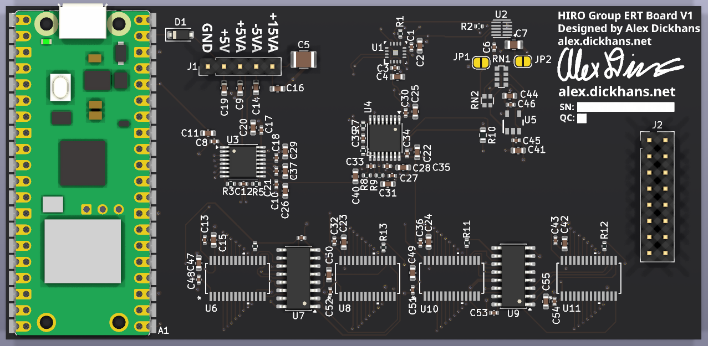

Top of the board, USB edge up. The Pico (A1) is on the left and its USB connector faces the top edge. J1 is the 5-pin header just to the right of the Pico. J2 is the 16-pin header on the right. JP1 and JP2 are the open yellow solder jumpers near the top. U1, U5, U6, U8, U10, and U11 have no 3D model in the footprint, so those locations show the pads and the silkscreen outline. The Pico, the headers, the passives, D1, U2, U3, U4, U7, U9, RN1, and RN2 are the models from their footprints, sitting on the lands.

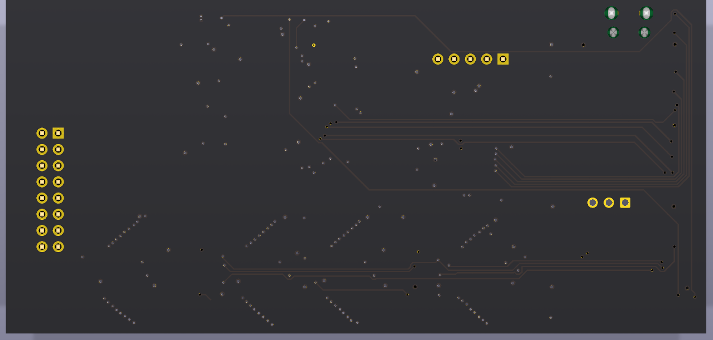

Bottom of the board, looking at the back, so left and right are swapped from the top photo. There are no parts on this side. The 2×8 set of holes on the left is J2. The five holes near the top are J1, and in this view the square pin-1 pad is the right-hand hole of that row. The four holes at the top right are the Pico USB shell holes.

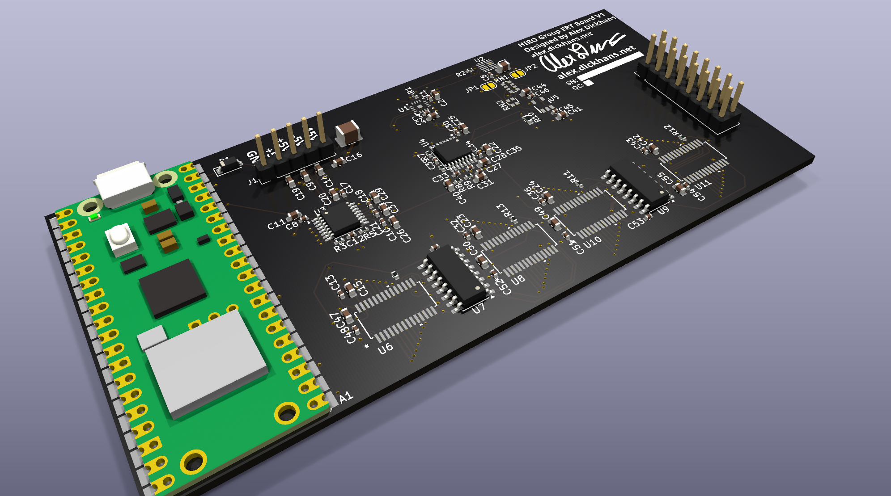

Three-quarter view of the top, USB edge toward the lower left. The header pins and the Pico body are 3D models on their lands. The four empty outlines along the lower edge are U6, U8, U10, and U11, drawn as footprints because those packages have no 3D model. U1 and U5 are the same: pads and silk, not a package body.

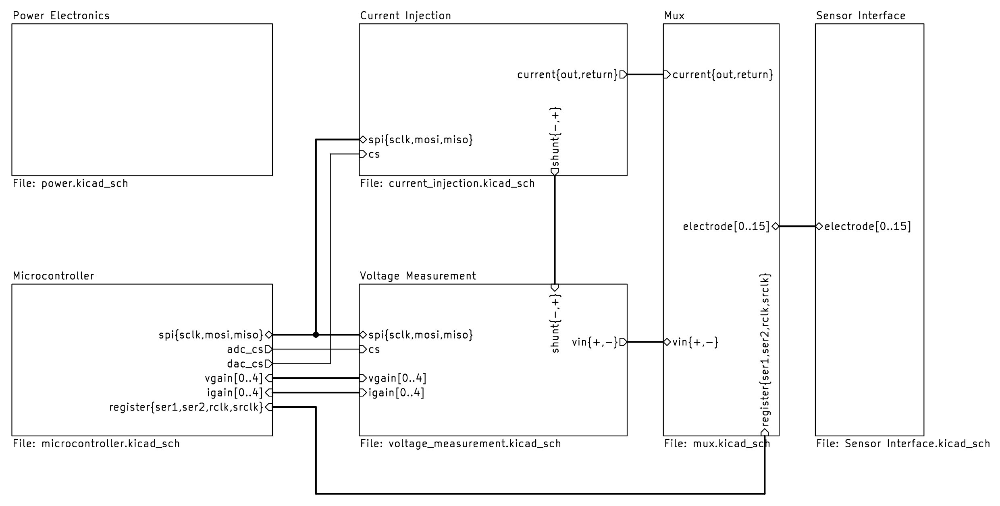

Root sheet. The blocks are the power connector, the Pico, the current source, the voltage and current measurement, the switches, and J2.

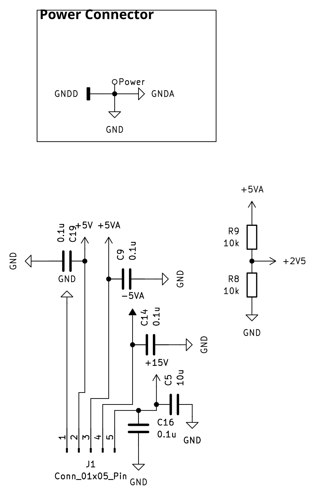

Power sheet. J1 pins, in schematic order, are GND, +5V, +5VA, ?5VA, and +15V. R9 and R8 divide +5VA to make +2V5. The names GND, GNDA, and GNDD are one net.

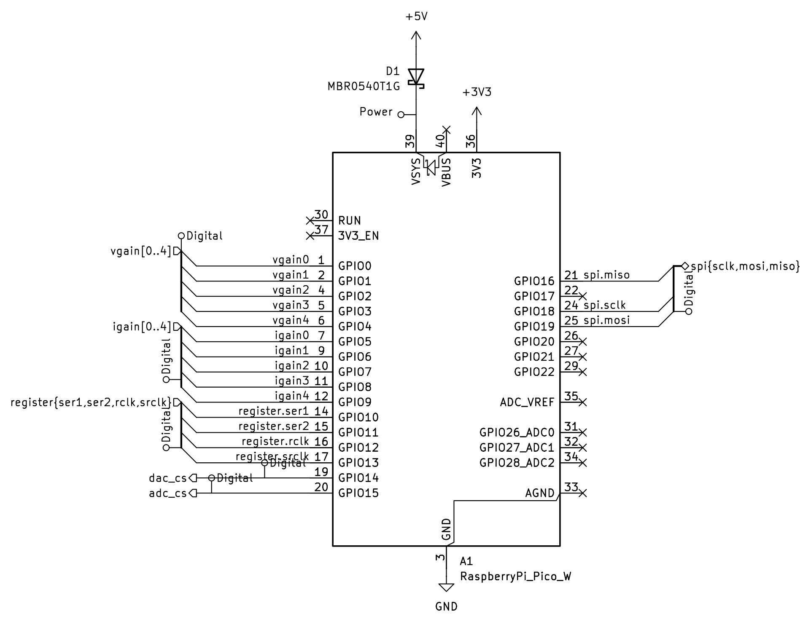

Pico sheet. D1 is the MBR0540T1G from J1 +5V into VSYS. VBUS, RUN, and 3V3_EN are open.

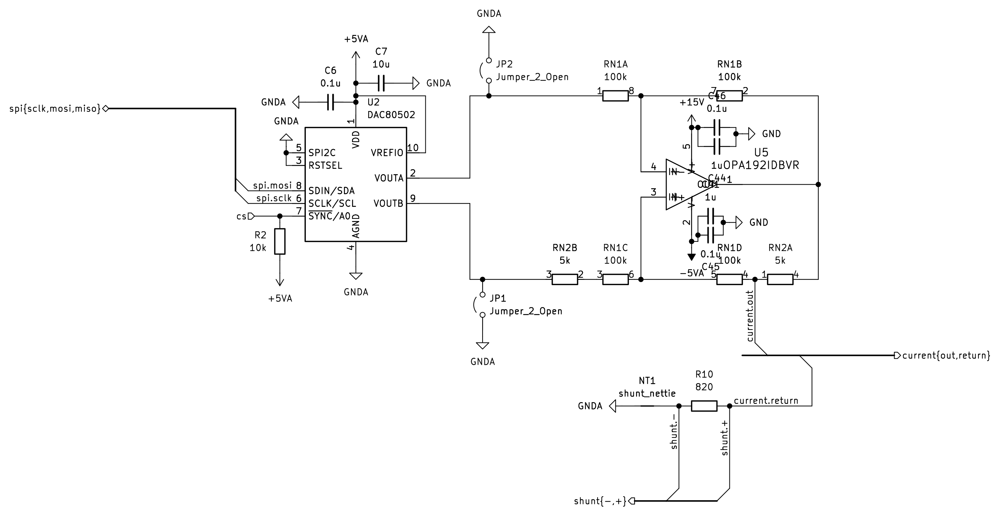

Current source. U2, U5, RN1, RN2, the 820 ? shunt R10, the copper short NT1, and the open jumpers JP1 and JP2.

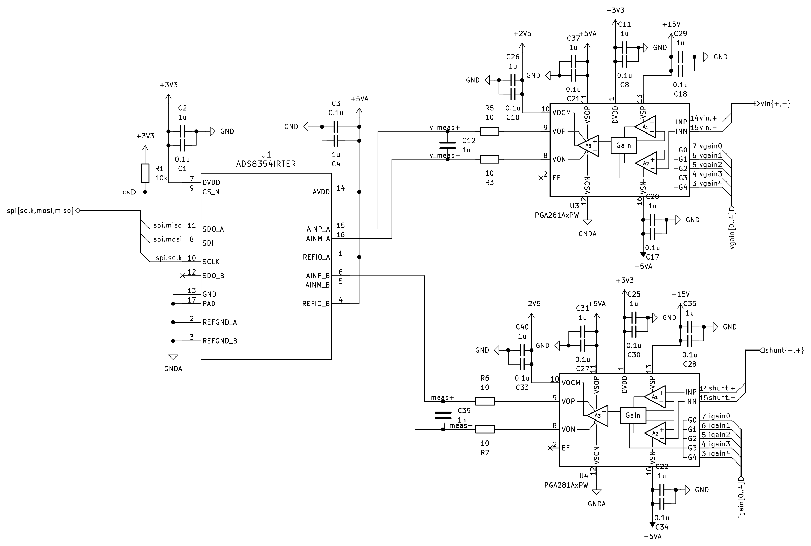

Measurement sheet. U3 is the voltage amplifier, U4 is the current amplifier, and U1 is the ADS8354.

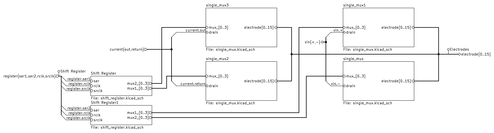

Switch sheet. U6 is the positive voltage switch, U8 is the negative voltage switch, U11 is the current output, and U10 is the current return. U9 addresses U10 and U11. U7 addresses U6 and U8.

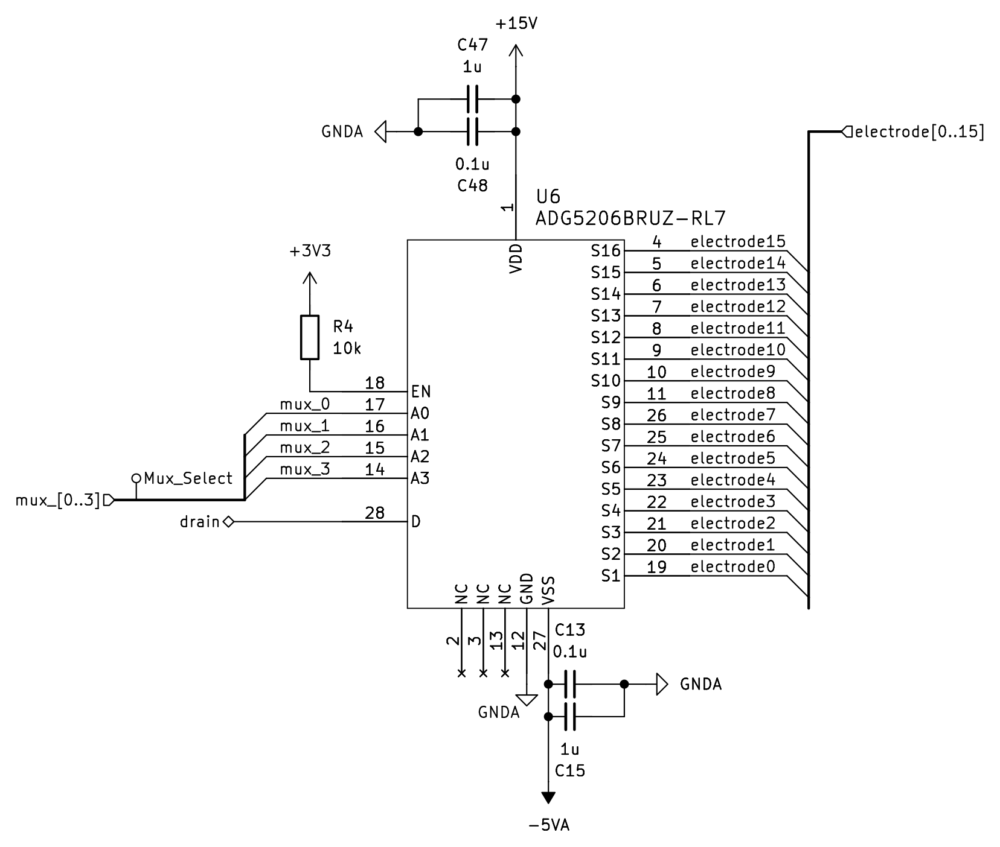

One switch, drawn for U6. U8, U10, and U11 use the same circuit. The drain (pin 28) is `vin.+` on U6, `vin.?` on U8, `shunt.+` on U10, and `current.out` on U11. S1 through S16 are electrodes 0 through 15.

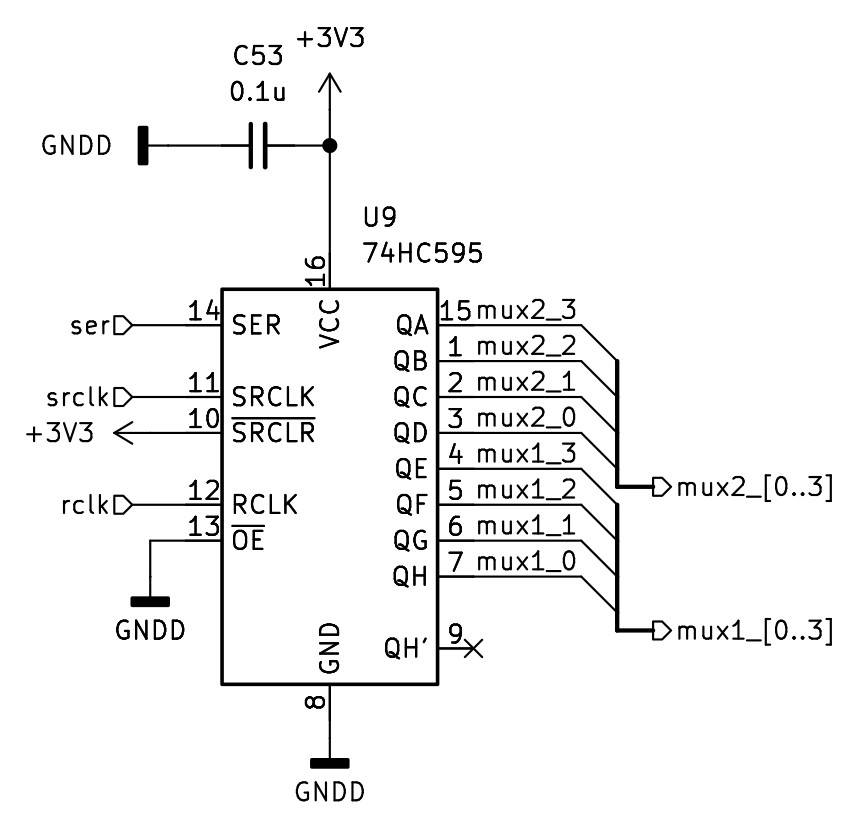

Shift register U9. U7 is the same circuit, with serial data from GPIO11, and it drives U6 and U8.

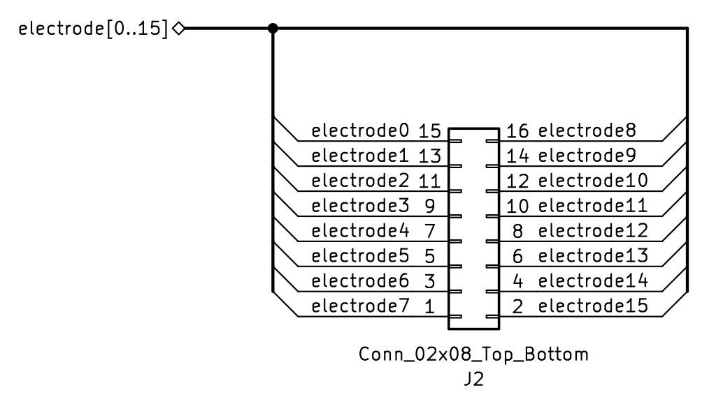

J2 on the schematic. Pin 1 is electrode 7. On this drawing, pin 1 is at the bottom of the left column. On the board, pin 1 is the square pad at the top of the column closer to the middle of the board. The net is electrode 7 either way.

## Connectors and holes

Orient the board with the USB edge up, as in the top photo. There are no mounting holes and no test points. The boxes marked SN: and QC: are silkscreen only.

| Silk | What it is |
| --- | --- |
| J1 | 1×5 pin header, 2.54 mm. Power input. Pin 1 is the square pad, the left end. |
| J2 | 2×8 pin header, 2.54 mm. Electrodes. Pin 1 is the square pad at the top of the inner column (the column closer to the middle of the board). The silk does not number the electrodes. |
| JP1 | Open solder jumper. Left pad is GND, right pad is U2 VOUTB. Leave it open. Closing it shorts VOUTB to ground. |
| JP2 | Open solder jumper. Left pad is U2 VOUTA, right pad is GND. Leave it open. Closing it shorts VOUTA to ground. |
| A1 | Raspberry Pi Pico W. Pin 1 of the footprint is the left pin at the USB end (GPIO0). The USB connector faces the top edge. |
| D1 | SOD-123 diode. Pin 1 is the left end, the cathode band, on Pico VSYS. The right end is the anode, on J1 +5V. |
| D1, D2, D3 | Three 1.0 mm plated holes under the Pico footprint. They have no net. The module covers them once it is soldered. These are not the diode D1. |

J1, left to right. The silkscreen above the pins reads GND, +5V, +5VA, ?5VA, +15VA. The net on the last pin is +15V.

| J1 pin | Silkscreen | Net |
| --- | --- | --- |
| 1 | GND | GND |
| 2 | +5V | +5V |
| 3 | +5VA | +5VA |
| 4 | ?5VA | ?5VA |
| 5 | +15VA | +15V |

J2, with the USB edge up. The inner column is toward the middle of the board.

| Inner pin | Electrode | Outer pin | Electrode |
| --- | --- | --- | --- |
| 1 (top, square) | 7 | 2 | 15 |
| 3 | 6 | 4 | 14 |
| 5 | 5 | 6 | 13 |
| 7 | 4 | 8 | 12 |
| 9 | 3 | 10 | 11 |
| 11 | 2 | 12 | 10 |
| 13 | 1 | 14 | 9 |
| 15 (bottom) | 0 | 16 | 8 |

Pico pins that leave the module. Pin 1 is the top pin on the left edge.

| Pico pin | GPIO | Net |
| --- | --- | --- |
| 1 | GPIO0 | vgain0, U3 gain |
| 2 | GPIO1 | vgain1 |
| 4 | GPIO2 | vgain2 |
| 5 | GPIO3 | vgain3 |
| 6 | GPIO4 | vgain4 |
| 7 | GPIO5 | igain0, U4 gain |
| 9 | GPIO6 | igain1 |
| 10 | GPIO7 | igain2 |
| 11 | GPIO8 | igain3 |
| 12 | GPIO9 | igain4 |
| 14 | GPIO10 | U9 serial data |
| 15 | GPIO11 | U7 serial data |
| 16 | GPIO12 | shift-register RCLK |
| 17 | GPIO13 | shift-register SRCLK |
| 19 | GPIO14 | U2 chip select |
| 20 | GPIO15 | U1 chip select |
| 21 | GPIO16 | SPI MISO |
| 24 | GPIO18 | SPI clock |
| 25 | GPIO19 | SPI MOSI |
| 36 | 3V3 out | +3V3 |
| 39 | VSYS | cathode of D1 |
| 40 | VBUS | open |

GPIO17, GPIO20, GPIO21, GPIO22, GPIO26, GPIO27, GPIO28, ADC_VREF, RUN, and 3V3_EN are open on the board. The four holes beside the USB connector are non-plated holes in the Pico footprint (two 2.2 mm, two 1.85 mm) for the USB shell.

R4 and C38 are fitted. Their reference designators are hidden on the silkscreen, so the board does not print "R4" or "C38".

## Power

All board power comes in on J1. Pin 1, the square pad on the left, is ground. Supply +5V, +5VA, ?5VA, and +15V on the pins in the table above. +5VA is a separate pin from +5V. The board does not make one from the other.

There is no regulator, no charger, and no battery on this board. +3V3 is the Pico's own regulator, from VSYS, and it comes out on Pico pin 36. +2V5 is only the midpoint of R9 (10 k? from +5VA) and R8 (10 k? to GND). It is the output common-mode pin of U3 and U4. Do not use it to power anything.

D1 lets J1 +5V feed Pico VSYS and blocks the Pico from driving +5V back out of J1. The Pico USB connector does not power the Pico and does not power the analog rails, because VBUS is open. Plug in J1 +5V before expecting the Pico, the switches, or the ADC to run. +5VA, ?5VA, and +15V go straight to the analog parts, with no reverse protection. JP1 and JP2 must stay open.

## Manufacturing

Order a 6-layer, 1.6 mm board, 109.4 mm by 52.5 mm. Copper is 1 oz (0.035 mm) on every layer. F.Cu, In2.Cu, In3.Cu, and B.Cu are signal layers. In1.Cu and In4.Cu are ground planes. Mask is black and silk is white, as set in the stackup. The board file does not name a surface finish, and it does not call for impedance control.

The smallest trace is 0.15 mm, on F.Cu and In2.Cu. The smallest clearance in the design rules is 0.15 mm, on the electrode nets, and DRC reported no clearance errors. Vias are 0.6 mm pad / 0.3 mm drill, and 0.8 mm pad / 0.4 mm drill. Plated holes are 1.0 mm (J1, J2, and the three holes under the Pico) and one 0.20 mm hole in the U1 exposed pad. Non-plated holes are the four Pico USB shell holes. The copper-to-edge rule in the board is 0.5 mm, and DRC reported no edge violations.

Send `production/eit.zip`. It contains the six copper layers, both solder masks, both silkscreens, both paste layers, the board outline, and one Excellon drill file. Coordinates are absolute, in millimeters, and the soldermask is subtracted from the silk. The bottom paste file is empty because every part is on the top. The drill file includes the plated and the non-plated holes. Do not add a drill map or a separate non-plated drill file.

`production/bom.csv` is the parts list: Designator, Comment, Footprint, Qty, and LCSC Part #. Comment is the value printed in the schematic. JP1, JP2, and NT1 are left off on purpose. A1 has no LCSC number; buy a Raspberry Pi Pico W and fit it to the handsolder footprint. C6, C38, and C53 are 0.1 µF in 0402 under LCSC C1525. The other 0.1 µF 0402 parts are C343047. Both are 100 nF, 0402. RN1 is one 4-resistor array, 100 k? each (LCSC package 0603×4, footprint `R_Array_Convex_4x0612`). RN2 is one 2-resistor array, 5 k? each (LCSC package 0603×2, footprint `R_Array_Convex_2x0606`). R10 is an 820 ? resistor on a 0603 resistor footprint.

`production/position.csv` is the KiCad placement file for both sides, in millimeters. DNP parts are excluded, and so are JP1, JP2, NT1, and the two silk logos. The header is Designator, Val, Package, Mid X, Mid Y, Rotation, Layer. Y is negative, the same origin as the gerbers. Do not flip Y, and do not negate X. Every part is on the top, so the Layer column reads `top`. The rotations are KiCad's. Check the assembler's placement preview before paying.

Parts that are easy to rotate the wrong way, with the USB edge as the top edge:

| Part | Pin 1 |
| --- | --- |
| A1 Pico W | Left pin at the USB end. The USB connector faces the top edge. |
| D1 | Left end. That end is the cathode band, on VSYS. |
| J1 | Square pad, left end. |
| J2 | Square pad, top of the inner column. |
| U1 | Corner toward the bottom-left of the package. |
| U2 | Corner toward the bottom-right of the package. |
| U3 | Corner toward the top-left of the package. |
| U4 | Corner toward the top-right of the package. |
| U5 | Lower pin on the left side of the SOT-23. |
| U6, U8, U10, U11 | Bottom-left corner of each TSSOP. The silkscreen outline is the footprint, not a drawn module. |
| U7, U9 | Bottom-right corner of each SOIC. |
| RN1 | Left end, the pad closer to the USB edge. |
| RN2 | Pad closer to the USB edge. |

## Design files

| Path | What it is |
| --- | --- |
| `eit.kicad_pro` | KiCad 9 project |
| `eit.kicad_sch` | Root schematic. The other `.kicad_sch` files are the sheets. |
| `eit.kicad_pcb` | Board |
| `production/eit.zip` | Gerbers and drill for this revision |
| `production/bom.csv` | Bill of materials |
| `production/position.csv` | Placement, both sides, millimeters |
| `images/` | The pictures above |
